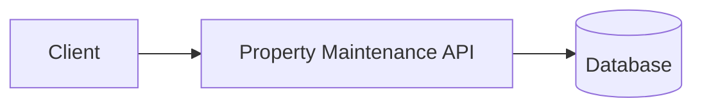
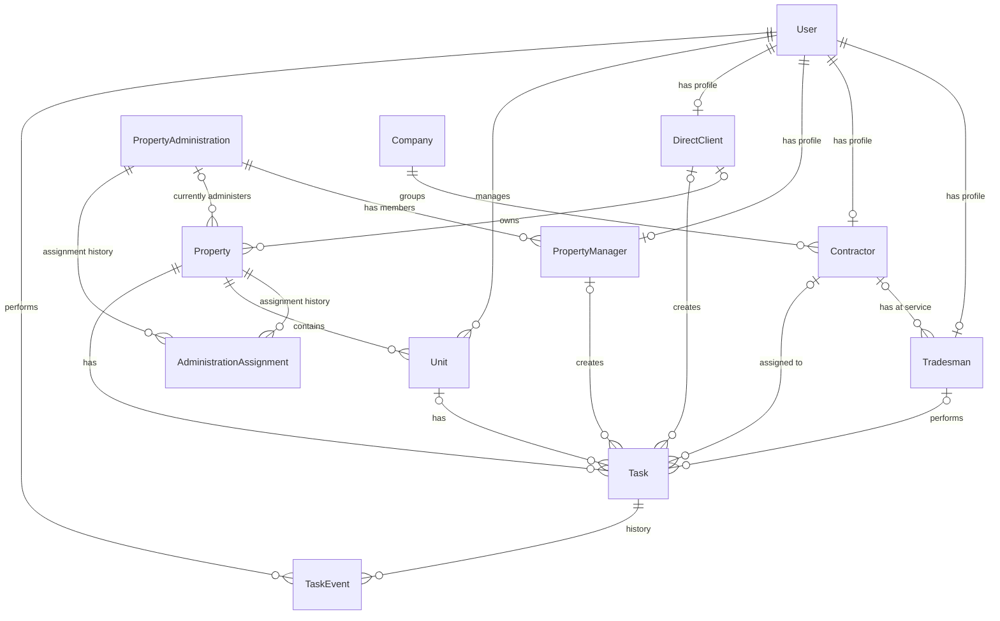
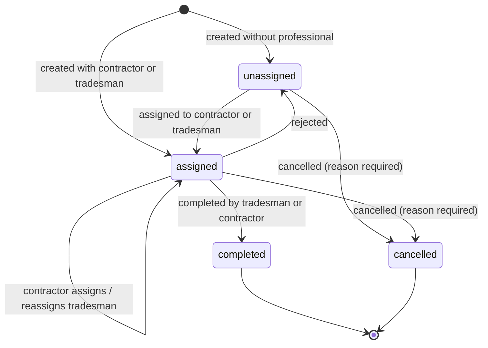

# System Design Specification — Property Maintenance API

> **Status:** Draft
> **Last updated:** 2026-10-20
> **Owner:** otsnd

This document collects the system's design decisions. Each section will be completed as requirements are defined. Entries marked `TBD` are pending definition.

---

## 1. Overview

### 1.1 Purpose

A platform that connects **property administrations** (consorcio administrators) and **individual property owners/tenants** with **tradespeople** and **contractor companies** who perform building repairs and maintenance, such as masons, electricians, plumbers, and similar trades.

### 1.2 Scope

| In scope | Out of scope |
| -------- | ------------ |
| `TBD`    | `TBD`        |

### 1.3 Glossary

| Term                    | Definition                                                                                                                  |
| ----------------------- | --------------------------------------------------------------------------------------------------------------------------- |
| Consorcio               | A condominium / homeowners' association that jointly owns and maintains the common areas of a building.                    |
| Property administration | The organization that administers one or more consorcios (Spanish: _administración de consorcios_). It is a **client**, not a Company. |
| Company                 | A company that groups one or more contractors. A Company is **not** a property administration.                             |
| Contractor              | A user who belongs to a Company, receives tasks, and has tradesmen at their service.                                        |
| Tradesman               | A professional who performs repair work in a given trade. Works independently or at the service of a contractor.                                   |
| Property manager        | A user who belongs to a property administration, either as `admin` or as `member`. _Placeholder name._                     |
| Direct client           | A private individual who lives in a private home and uses the app to request repairs for it. Does not belong to any property administration.      |
| Trade                   | The specialty a tradesman offers (electrician, handyman, plumber, etc.).                                                    |
| Property                | A house or building where repairs take place. A building knows which property administration (consorcio administration) it is assigned to.                                                                               |
| Unit                    | A functional unit (apartment, office, etc.) inside a property.                                                              |
| Task                    | A repair or maintenance job created by a property manager or a direct client, and assigned to a contractor or directly to a tradesman.                                    |

---

## 2. Actors and roles

| Role                       | Description                                                                                 | Main permissions                                                                  |
| -------------------------- | ------------------------------------------------------------------------------------------- | --------------------------------------------------------------------------------- |
| Platform owner             | Owner of the application. Super-roles to be defined later.                                 | Create property administrations and their first `admin` user.                    |
| Property manager (admin)   | Administrator of a property administration. _Placeholder name._                            | Create and manage the administration's member users. Everything a member can do. |
| Property manager (member)  | User created by an admin, with restricted permissions. _Placeholder name._                 | Create, assign, and cancel tasks, and view existing tasks (for now).                                   |
| Direct client              | Private individual requesting repairs for their own home. Not part of any administration.  | Request repairs (create tasks) for their home, choose the contractor or tradesman, and cancel their tasks.                                    |
| Contractor                 | Belongs to a Company. Receives tasks and has tradesmen at their service.                   | Receive tasks, assign or reassign them to one of their tradesmen, reject them, or mark them as completed. |
| Tradesman                  | Performs repair work in one or more trades, independently or at the service of a contractor. | View their tasks, mark them as completed, and reject tasks assigned to them directly. |

Business rules:

- Property administrations are clients. A Company is **not** a property administration.
- A property manager belongs to exactly one property administration, with an administration role of `admin` or `member`.
- The first `admin` user of an administration is created by the platform owner (for now).
- An administration's `admin` user creates `member` users with fewer permissions.
- Both `admin` and `member` users can create tasks.
- Each building is assigned to one property administration at a time, and knows which one it is.
- A building can change administration over time. The full assignment history is kept.
- Property managers can only create tasks for buildings currently assigned to their administration.
- When a building changes administration, the new administration can view the tasks managed by previous administrations, so it can follow the management history. The previous administration loses access to the building's tasks.
- An administration can have more than one `admin`.
- Open (not completed) tasks remain visible to the new administration, which continues managing them.
- Direct clients do not belong to any administration; they request repairs for their own home and choose the contractor or tradesman themselves.
- A direct client can have more than one home. Each home belongs to exactly one direct client (for now).
- A task can be assigned to a contractor or directly to a tradesman.
- When a task is assigned to a contractor, the contractor must assign it to one of their tradesmen.
- A contractor can reject a task, or reassign it to another of their tradesmen.
- A tradesman can reject a task only if it was assigned to them directly.
- A task can be rejected at any point before it is completed or cancelled. A rejected task becomes unassigned, so another professional can be picked. Its date is kept for administration tasks, and cleared for direct client tasks. The rejection can include a reason (optional, for now).
- The administration sets the task's date when creating it, before handing it to the contractor. A direct client agrees the date with the professional instead.
- Tasks will be reschedulable in the future, backed by an availability calendar. Administration tasks can be rescheduled by the administration or the contractor; direct client tasks by the direct client or the assigned professional.
- A task can be marked as completed by its tradesman or by the contractor who holds it.
- A task on an administration's building can be cancelled by any property manager of that administration. A direct client's task can be cancelled by that direct client. A cancellation requires a reason.
- The full history of a task (creation, assignments, reassignments, rejections, completion, cancellation) is kept, including who did each action.
- The tradesman's experience must be minimal: they only see their tasks and mark them as completed.
- Every task has a title, a description, the trade it requires, and a status.
- A Company groups one or more contractors. A contractor **must** belong to a Company.
- A tradesman can work independently or at the service of **one** contractor at a time (for now).
- A tradesman can have more than one trade.

---

## 3. Requirements

### 3.1 Functional requirements

| ID     | Description | Priority | Status  |
| ------ | ----------- | -------- | ------- |
| FR-001 | The platform owner can create property administrations and their first `admin` user. | `TBD` | Pending |
| FR-002 | An administration `admin` can create `member` users for their administration. | `TBD` | Pending |
| FR-003 | Property managers (`admin` and `member`) can create tasks for buildings assigned to their administration, assign them, and view existing tasks. | `TBD` | Pending |
| FR-004 | Direct clients can create tasks for their home and choose the contractor or tradesman. | `TBD` | Pending |
| FR-005 | A task can be assigned to a contractor or directly to a tradesman. | `TBD` | Pending |
| FR-006 | A contractor can assign a task they received to one of their tradesmen. | `TBD` | Pending |
| FR-007 | Search for professionals (contractors and tradesmen), ordered/grouped by trade. | `TBD` | Future |
| FR-008 | A building's administration can be changed, keeping the history of past assignments. | `TBD` | Pending |
| FR-009 | After a change of administration, the new administration can view tasks managed by previous administrations of the building. The previous administration loses access to them. | `TBD` | Pending |
| FR-010 | After a change of administration, the new administration can continue managing the building's open tasks. | `TBD` | Pending |
| FR-011 | A contractor can reject a task assigned to them. | `TBD` | Pending |
| FR-012 | A contractor can reassign a task to another of their tradesmen. | `TBD` | Pending |
| FR-013 | A tradesman can reject a task that was assigned to them directly. | `TBD` | Pending |
| FR-014 | A direct client can register more than one home. | `TBD` | Pending |
| FR-015 | When rejecting a task, the contractor or tradesman can optionally give a reason. | `TBD` | Pending |
| FR-016 | A rejected task returns to `unassigned` so its creator can assign it to another professional. | `TBD` | Pending |
| FR-017 | Every task exposes its current status (`unassigned`, `assigned`, `completed`, `cancelled`). | `TBD` | Pending |
| FR-018 | Any property manager of the administration (or the direct client, for their own tasks) can cancel a task before it is completed, giving a mandatory reason. | `TBD` | Pending |
| FR-019 | A task can be rejected at any point before it is completed or cancelled. | `TBD` | Pending |
| FR-020 | The full history of each task (who did what, and when) is kept and can be viewed. | `TBD` | Pending |
| FR-021 | A tradesman can list their tasks and mark them as completed. | `TBD` | Pending |
| FR-022 | The administration sets the date of a task (`scheduledAt`) when creating it. | `TBD` | Pending |
| FR-023 | A contractor can mark a task they hold as completed. | `TBD` | Pending |
| FR-024 | Direct clients can create tasks without a date, to be agreed with the professional. | `TBD` | Pending |
| FR-025 | Availability calendar so clients and professionals can agree on a date. | `TBD` | Future |
| FR-026 | Reschedule a task (change its date), recording a `rescheduled` event. Allowed for the administration or the contractor (administration tasks), and for the direct client or the assigned professional (direct client tasks). | `TBD` | Future |
| FR-027 | When a direct client's task is rejected, its agreed date is cleared. | `TBD` | Pending |

### 3.2 Non-functional requirements

| ID      | Category      | Description | Metric / Target |
| ------- | ------------- | ----------- | --------------- |
| NFR-001 | Performance   | `TBD`       | `TBD`           |
| NFR-002 | Availability  | `TBD`       | `TBD`           |
| NFR-003 | Security      | `TBD`       | `TBD`           |
| NFR-004 | Scalability   | `TBD`       | `TBD`           |
| NFR-005 | Observability | `TBD`       | `TBD`           |
| NFR-006 | Usability     | The tradesman's flow must be minimal: see their tasks and mark them as completed, nothing else. | `TBD` |

---

## 4. Architecture

### 4.1 Technology stack

| Layer           | Technology                    | Status  |
| --------------- | ----------------------------- | ------- |
| Runtime         | Node.js (ESM)                 | Defined |
| Language        | TypeScript 6                  | Defined |
| Framework       | NestJS 12 (Express)           | Defined |
| Package manager | pnpm                          | Defined |
| Testing         | Vitest + Supertest            | Defined |
| Lint / Format   | oxlint + Prettier             | Defined |
| Database        | `TBD`                         | Pending |
| ORM / Data access | `TBD`                       | Pending |
| Authentication  | `TBD`                         | Pending |
| Cache / Queues  | `TBD`                         | Pending |
| File storage    | `TBD` (files, photos, etc.)   | Pending |

### 4.2 Architectural style

`TBD`: modular monolith, layered, hexagonal, etc.

### 4.3 Component diagram

### 4.4 Module structure

| Module | Responsibility | Dependencies |
| ------ | -------------- | ------------ |
| `TBD`  | `TBD`          | `TBD`        |

---

## 5. Domain model

### 5.1 Entities

| Entity                 | Description                                                         |
| ---------------------- | ------------------------------------------------------------------- |
| User                   | Base account for every person in the system. Typed by `role`.      |
| Tradesman              | User profile for a professional, independent or at the service of a contractor.     |
| Contractor             | User profile for a member of a Company who receives tasks.          |
| PropertyManager        | User profile for a member of a property administration (`admin` or `member`). _Placeholder name._ |
| DirectClient           | User profile for a private individual tied to their own home.       |
| Company                | Company that groups contractors.                                    |
| PropertyAdministration | Organization (client) that administers consorcios.                  |
| Property               | A house or building.                                                |
| AdministrationAssignment | Historical record of which administration a building had, and when. |
| Unit                   | A functional unit inside a property.                                |
| Task                   | A repair or maintenance job.                                        |
| TaskEvent              | Append-only history of everything that happened to a task.          |

#### User

| Field        | Type   | Notes                                                                    |
| ------------ | ------ | ------------------------------------------------------------------------ |
| `uuid`       | UUID   | Primary key.                                                             |
| `name`       | string |                                                                          |
| `middleName` | string | Optional.                                                                |
| `lastName`   | string |                                                                          |
| `role`       | enum   | `tradesman` \| `contractor` \| `propertyManager` \| `directClient`.     |

Each role has a profile with role-specific fields:

| Profile         | Field                | Type | Notes                                                                 |
| --------------- | -------------------- | ---- | --------------------------------------------------------------------- |
| Tradesman       | `trades`             | enum[] | One or more trades. See [Trade](#trade).                            |
| Tradesman       | `contractorId`       | UUID | Optional. FK → User (contractor). Empty for independent tradesmen. A tradesman works for **one contractor at a time** (for now). |
| Contractor      | `companyId`          | UUID | **Required.** FK → Company.                                           |
| PropertyManager | `administrationId`   | UUID | **Required.** FK → PropertyAdministration.                            |
| PropertyManager | `administrationRole` | enum | `admin` \| `member`. Replaces the former `propertyRole` (`admin` \| `owner`). |

A direct client can have several homes. The link is stored on the home itself (`Property.directClientId`), not on the profile.

#### Trade

Enum: `electrician`, `handyman`, `plumber`, … (list to be extended).

#### Company

| Field         | Type | Notes        |
| ------------- | ---- | ------------ |
| `uuid`        | UUID | Primary key. |
| Payment data  | TBD  | To be defined. |

#### PropertyAdministration

| Field         | Type   | Notes          |
| ------------- | ------ | -------------- |
| `uuid`        | UUID   | Primary key.   |
| `name`        | string |                |
| Payment data  | TBD    | To be defined. |

#### Property

| Field          | Type   | Notes                                              |
| -------------- | ------ | -------------------------------------------------- |
| `uuid`         | UUID   | Primary key.                                       |
| `propertyType` | enum   | `house` \| `building`.                             |
| `address`      | object | See below.                                         |
| `administrationId` | UUID | FK → PropertyAdministration **currently** assigned to the building. Empty for direct clients' homes. Past assignments live in [AdministrationAssignment](#administrationassignment). |
| `directClientId` | UUID | FK → User (direct client) who owns this home. Empty for buildings managed by an administration. |

`address`:

| Field          | Type   | Notes                                      |
| -------------- | ------ | ------------------------------------------ |
| `street`       | string |                                            |
| `number`       | string |                                            |
| `postalCode`   | string |                                            |
| `intersection` | string | Nearest cross street(s) ("entre calles"). |

#### AdministrationAssignment

One row per period in which a building was administered by a given administration.

| Field              | Type      | Notes                                                    |
| ------------------ | --------- | -------------------------------------------------------- |
| `uuid`             | UUID      | Primary key.                                             |
| `propertyId`       | UUID      | FK → Property.                                           |
| `administrationId` | UUID      | FK → PropertyAdministration.                             |
| `startedAt`        | timestamp | When the administration took over the building.          |
| `endedAt`          | timestamp | Optional. Empty while the assignment is current.         |

Rules:

- A building has at most one assignment with an empty `endedAt` at any time.
- Changing a building's administration closes the current assignment (`endedAt`), opens a new one, and updates `Property.administrationId`, in a single transaction.

#### Unit

| Field        | Type   | Notes                                           |
| ------------ | ------ | ----------------------------------------------- |
| `uuid`       | UUID   | Primary key.                                    |
| `unitId`     | string | Human-readable identifier within the property (e.g. `4B`). |
| `propertyId` | UUID   | FK → Property.                                  |
| `managerId`  | UUID   | FK → User. Which kind of user is still to be defined with the product team. |

#### Task

| Field         | Type      | Notes                                                  |
| ------------- | --------- | ------------------------------------------------------ |
| `uuid`        | UUID      | Primary key.                                           |
| `title`       | string    | Short summary of the job.                              |
| `description` | text      | Details of the problem / work to be done.              |
| `trade`       | enum      | Trade required for the job. See [Trade](#trade).       |
| `status`      | enum      | `unassigned` \| `assigned` \| `completed` \| `cancelled`. See [lifecycle](#53-states-and-lifecycles). |
| `createdAt`   | timestamp |                                                        |
| `updatedAt`   | timestamp |                                                        |
| `scheduledAt` | timestamp | When the work is planned to happen. Administration tasks: set when creating the task. Direct client tasks: optional, set once agreed with the professional. |
| `completedAt` | timestamp | Optional. Set when the work is finished.               |
| `cancelledAt` | timestamp | Optional. Set when the task is cancelled.              |
| `createdBy`   | UUID      | FK → User (property manager or direct client) who created the task. |
| `contractorId`| UUID      | Optional. FK → User (contractor), when assigned to a contractor. |
| `tradesmanId` | UUID      | Optional. FK → User (tradesman) who performs the work. Set directly, or by the contractor. |
| `propertyId`  | UUID      | FK → Property.                                         |
| `unitId`      | UUID      | Optional. FK → Unit; empty for common-area tasks.      |

`Task` holds the **current** state. Its full history lives in [TaskEvent](#taskevent).

Scheduling rules:

- The administration defines the date (`scheduledAt`) when creating the task, before handing it to the contractor.
- A direct client agrees the date with the professional, since it depends on both parties' availability. Their tasks can exist without a date until it is agreed.
- _Future:_ an availability calendar to agree dates, and a way to reschedule a task (change `scheduledAt`). Each reschedule is recorded as a `rescheduled` event. Who can reschedule:
  - Administration tasks: any property manager of the administration, or the contractor who holds the task.
  - Direct client tasks: the direct client, or the assigned professional (contractor or tradesman).

Assignment rules:

- A task is assigned either to a contractor (`contractorId`) or directly to a tradesman (`tradesmanId`).
- When assigned to a contractor, the contractor sets `tradesmanId` to one of **their own** tradesmen.
- When assigned directly to a tradesman, `contractorId` stays empty.
- The task's company is not stored on `Task`; it is derived from the assigned contractor (`Contractor.companyId`).
- A contractor can reject a task assigned to them, or reassign it to another of their tradesmen.
- A tradesman can reject a task **only** if it was assigned to them directly. Tasks received through their contractor cannot be rejected by the tradesman.
- A task can be rejected at any point before it is `completed` or `cancelled`.
- A rejected task becomes **unassigned**: `contractorId` and `tradesmanId` are cleared and `status` goes back to `unassigned`, so another professional can be picked. For administration tasks `scheduledAt` is kept, since the administration defined it. For direct client tasks `scheduledAt` is cleared, since it was agreed with the professional who rejected it.

Cancellation rules:

- A task on a building managed by an administration can be cancelled by **any** property manager of that administration, not only its creator.
- A direct client's task can be cancelled by that direct client.
- A task can be cancelled at any point before it is `completed`.
- A cancellation **requires** a reason, and is recorded in the task's history.

#### TaskEvent

Append-only history of a task. Every relevant action creates one row, in the same transaction that updates `Task`. Replaces the former `TaskAssignment` entity, which could not record actions on unassigned tasks (e.g. cancelling a task nobody held).

| Field          | Type      | Notes                                                                                     |
| -------------- | --------- | ----------------------------------------------------------------------------------------- |
| `uuid`         | UUID      | Primary key.                                                                              |
| `taskId`       | UUID      | FK → Task.                                                                                |
| `type`         | enum      | `created` \| `assigned` \| `reassigned` \| `rejected` \| `rescheduled` \| `completed` \| `cancelled`. `rescheduled` will be used once rescheduling exists. |
| `actorId`      | UUID      | FK → User who performed the action.                                                       |
| `occurredAt`   | timestamp |                                                                                           |
| `contractorId` | UUID      | Optional. For `assigned` / `reassigned`: the new contractor. For `rejected`: the one who held the task. |
| `companyId`    | UUID      | Optional. Contractor's company at the time of the event (snapshot, since a contractor may change company later). |
| `tradesmanId`  | UUID      | Optional. Same as above, for the tradesman.                                               |
| `reason`       | text      | **Required** for `cancelled`. Optional for `rejected`. Empty otherwise.                   |

Rules:

- Rows are never updated or deleted.
- The task's assignment periods (who held it, from when to when) can be derived from its `assigned`, `reassigned`, and `rejected` events.

### 5.2 Relationships

### 5.3 States and lifecycles

#### Task

Stored in `Task.status`.

| Status       | Meaning                                                                                 |
| ------------ | --------------------------------------------------------------------------------------- |
| `unassigned` | No contractor or tradesman. Initial state, or after a rejection.                        |
| `assigned`   | Assigned to a contractor (with or without a tradesman yet) or directly to a tradesman. |
| `completed`  | The work is finished (`completedAt`). Final.                                             |
| `cancelled`  | Cancelled before completion (`cancelledAt`). Final.                                      |

There is no `scheduled` status: the date is set when the task is created, so it is a field (`scheduledAt`), not a state.

There is intentionally no `inProgress` status: the tradesman's experience must stay minimal (see [roles](#2-actors-and-roles)).

---

## 6. API design

### 6.1 Conventions

- **Style:** `TBD` (REST / GraphQL)
- **Versioning:** `TBD`
- **Format:** JSON
- **Resource naming:** `TBD`
- **Pagination:** `TBD`
- **Filtering and sorting:** `TBD`
- **Dates:** ISO 8601 in UTC
- **Documentation:** `TBD` (OpenAPI / Swagger)

### 6.2 Endpoints

| Method | Path  | Description | Required role |
| ------ | ----- | ----------- | ------------- |
| `TBD`  | `TBD` | `TBD`       | `TBD`         |

### 6.3 Error format

`TBD`: standard error response structure and error code catalog.

---

## 7. Security

- **Authentication:** `TBD`
- **Authorization:** `TBD`
- **Input validation:** `TBD`
- **Secrets management:** `TBD`
- **Sensitive data protection:** `TBD`
- **Rate limiting:** `TBD`

---

## 8. External integrations

| Service | Purpose | Integration type |
| ------- | ------- | ---------------- |
| `TBD`   | `TBD`   | `TBD`            |

---

## 9. Operations

### 9.1 Configuration and environments

| Environment | Purpose     | Notes |
| ----------- | ----------- | ----- |
| local       | Development | `TBD` |
| staging     | `TBD`       | `TBD` |
| production  | `TBD`       | `TBD` |

### 9.2 Deployment

`TBD`: infrastructure, containers, CI/CD.

### 9.3 Observability

- **Logging:** `TBD`
- **Metrics:** `TBD`
- **Tracing:** `TBD`
- **Health checks:** `TBD`

---

## 10. Testing strategy

| Type       | Tool               | Location           | Scope |
| ---------- | ------------------ | ------------------ | ----- |
| Unit       | Vitest             | `src/**/*.spec.ts` | `TBD` |
| End-to-end | Vitest + Supertest | `test/`            | `TBD` |

---

## 11. Architecture decision records (ADR)

| ID      | Date  | Decision | Status |
| ------- | ----- | -------- | ------ |
| ADR-001 | `TBD` | `TBD`    | `TBD`  |

---

## 12. Open questions

Domain model:

- [ ] Final name for the `PropertyManager` role (current name is a placeholder).
- [ ] Platform super-roles (platform owner, staff, etc.) and their permissions.
- [ ] Can a tradesman work for several contractors at once in the future? (Currently one at a time.)
- [ ] Can a home be shared by more than one direct client in the future? (Currently 1:1.)
- [ ] Is `Unit.managerId` a property manager, a direct client, or a unit owner/tenant? _To be defined with the product team._
- [ ] Payment data for `Company` and `PropertyAdministration`.
- [ ] Field naming convention for persistence and API (`camelCase` vs `snake_case`). This document uses `camelCase`.

Deferred (not part of the current business-focused design phase):

- [ ] Who can change a building's administration (platform owner, the new administration, the old one)?
- [ ] Until the availability calendar exists, how does a direct client's task get its date? (e.g. agreed outside the app and entered by the client or the professional, or left empty.)
