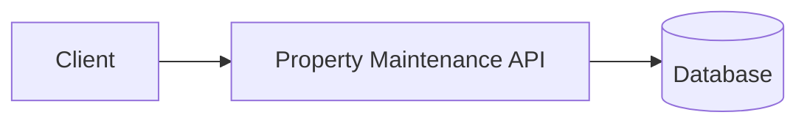
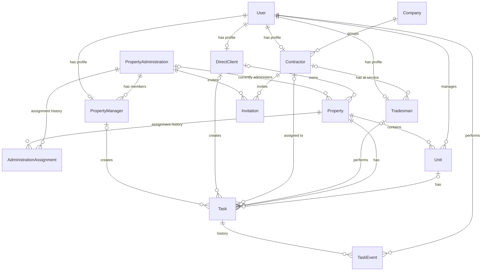
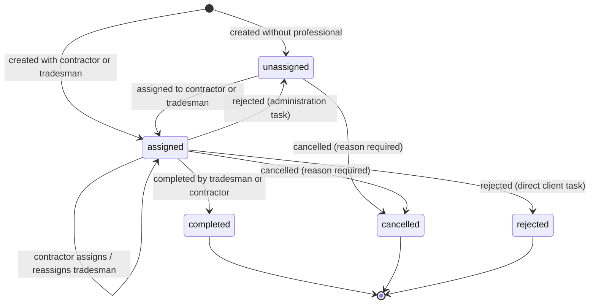
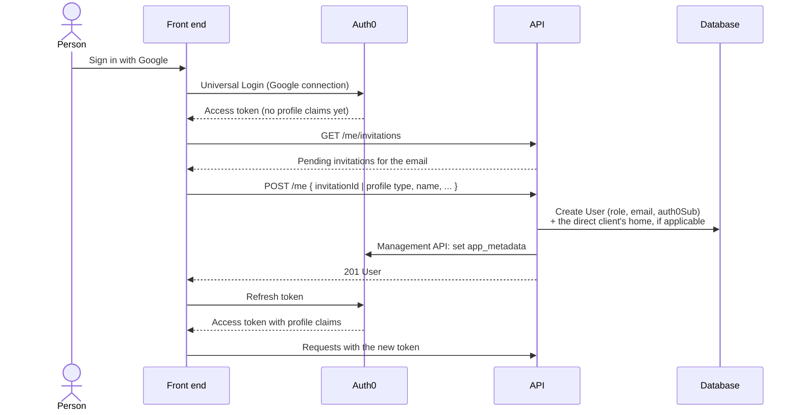

# System Design Specification — Property Maintenance API

> **Status:** Draft
> **Last updated:** 2026-10-24
> **Owner:** otsnd

This document collects the system's design decisions. Each section will be completed as requirements are defined. Entries marked `TBD` are pending definition.

---

## 1. Overview

### 1.1 Purpose

A platform that connects **property administrations** (firms that manage condominium associations) and **individual property owners/tenants** with **tradespeople** and **contractor companies** who perform building repairs and maintenance, such as masons, electricians, plumbers, and similar trades.

### 1.2 Scope

The MVP covers a single end-to-end flow: **a direct client books an independent tradesman**. Each requirement's priority (`MVP`, `Post-MVP`, `Future`) is in [Functional requirements](#31-functional-requirements).

| In scope (MVP) | Out of scope (post-MVP) |
| -------------- | ----------------------- |
| Sign-up with Google and onboarding: choosing the profile type, a direct client registering their first home, a tradesman setting and updating their trades. | Registering more than one home per direct client. |
| A direct client searching independent tradesmen by trade and viewing their free slots. | Tasks created by property managers, and anything else administration-related beyond what is already built (onboarding, properties, change of administration). |
| Booking a slot, which creates a task assigned to the tradesman, with slot and collision rules. | Contractors receiving, assigning, reassigning, rejecting, or completing tasks. |
| The tradesman's agenda: listing their tasks, marking them as completed, and rejecting them (with an optional reason). | Invitations and transactional email. |
| A direct client listing and cancelling their tasks (with a mandatory reason). | Availability settings, rescheduling, and in-app notifications (`Future`). |
| Task history (`TaskEvent`). | |

Property manager and contractor onboarding, administrations, and properties are already implemented. They are kept, but not extended during the MVP.

### 1.3 Glossary

| Term                    | Definition                                                                                                                  |
| ----------------------- | --------------------------------------------------------------------------------------------------------------------------- |
| Condominium association | The owners of the units of a building, organized to jointly maintain its common areas. Managed by a property administration. |
| Property administration | The organization that manages one or more condominium associations. It is a **client**, not a Company. |
| Company                 | A company that groups one or more contractors. A Company is **not** a property administration.                             |
| Contractor              | A user who belongs to a Company, receives tasks, and has tradesmen at their service.                                        |
| Tradesman               | A professional who performs repair work in a given trade. Works independently or at the service of a contractor.                                   |
| Property manager        | A user who belongs to a property administration, either as `admin` or as `member`. _Placeholder name._                     |
| Direct client           | A private individual who lives in a private home and uses the app to request repairs for it. Does not belong to any property administration.      |
| Trade                   | The specialty a tradesman offers (electrician, handyman, plumber, etc.).                                                    |
| Property                | A house or building where repairs take place. A building knows which property administration it is assigned to.                                                                               |
| Unit                    | A functional unit (apartment, office, etc.) inside a property.                                                              |
| Task                    | A repair or maintenance job created by a property manager or a direct client, and assigned to a contractor or directly to a tradesman.                                    |
| Profile type            | The kind of user a person is in the app (`propertyManager`, `directClient`, `contractor`, `tradesman`). Chosen by the person when they sign up. |
| Onboarding              | The step after a person's first sign-in in which they choose their profile type and become a User of the app. |
| Slot                    | A 30-minute period, starting on the hour or half hour between 07:00 and 18:30, in which a task can be scheduled. A direct client books a tradesman by picking one of their free slots. |
| Agenda                  | A tradesman's scheduled tasks, ordered by date.                                                                             |

---

## 2. Actors and roles

| Role                       | Description                                                                                 | Main permissions                                                                  |
| -------------------------- | ------------------------------------------------------------------------------------------- | --------------------------------------------------------------------------------- |
| Platform owner             | Owner of the application (superadmin). Signs in with a username and password, never with SSO. See [7.3](#73-platform-owner-accounts). | List and force-delete Users of any profile type, e.g. to repeat sign-up tests with the same Google account. Administrations and Companies are created by their own users at sign-up. |
| Property manager (admin)   | Administrator of a property administration. _Placeholder name._                            | Create and manage the administration's member users. Everything a member can do. |
| Property manager (member)  | User created by an admin, with restricted permissions. _Placeholder name._                 | Create, assign, and cancel tasks, and view existing tasks (for now).                                   |
| Direct client              | Private individual requesting repairs for their own home. Not part of any administration.  | Register their home, search tradesmen by trade, book a slot with one (which creates a task for their home), and cancel their tasks. |
| Contractor                 | Belongs to a Company. Receives tasks and has tradesmen at their service.                   | Receive tasks, assign or reassign them to one of their tradesmen, reject them, or mark them as completed. |
| Tradesman                  | Performs repair work in one or more trades, independently or at the service of a contractor. | View their agenda (their tasks), mark tasks as completed, reject tasks assigned to them directly, and update their trades. |

Business rules:

- Property administrations are clients. A Company is **not** a property administration.
- A property manager belongs to at most one property administration, with an administration role of `admin` or `member`. Until they create (or join) one, they can only create it.
- A person who signs up as a property manager creates their own administration in a separate step after sign-up, and becomes its first `admin`.
- An administration's `admin` invites people by email to join the administration as `member` (fewer permissions) or as another `admin`.
- Both `admin` and `member` users can create tasks.
- Each building is assigned to one property administration at a time, and knows which one it is.
- A building can change administration over time. The full assignment history is kept.
- Property managers can only create tasks for buildings currently assigned to their administration.
- When a building changes administration, the new administration can view the tasks managed by previous administrations, so it can follow the management history. The previous administration loses access to the building's tasks.
- An administration can have more than one `admin`.
- Open (not completed) tasks remain visible to the new administration, which continues managing them.
- Direct clients do not belong to any administration; they request repairs for their own home by booking a tradesman themselves.
- A direct client searches independent tradesmen by trade and books one of their free slots. Booking creates a task for the client's home, assigned directly to that tradesman. Booking a contractor is not supported for now.
- A tradesman can never have two tasks in the same slot. See [Agenda and collision rules](#task).
- A direct client can have more than one home. Each home belongs to exactly one direct client (for now).
- A task can be assigned to a contractor or directly to a tradesman.
- When a task is assigned to a contractor, the contractor must assign it to one of their tradesmen.
- A contractor can reject a task, or reassign it to another of their tradesmen.
- A tradesman can reject a task only if it was assigned to them directly.
- A task can be rejected at any point before it is completed or cancelled. The rejection can include a reason (optional, for now).
- A rejected administration task becomes unassigned, keeping its date, so another professional can be picked.
- A rejected direct client task ends as `rejected`. To try again, the client books a new slot, which creates a new task. Direct client tasks are never reused.
- The administration sets the task's date when creating it, before handing it to the contractor. A direct client sets it by booking a slot of the tradesman.
- Tasks will be reschedulable in the future. Administration tasks can be rescheduled by the administration or the contractor; direct client tasks by the direct client or the assigned professional.
- A task can be marked as completed by its tradesman or by the contractor who holds it.
- A task on an administration's building can be cancelled by any property manager of that administration. A direct client's task can be cancelled by that direct client. A cancellation requires a reason.
- The full history of a task (creation, assignments, reassignments, rejections, completion, cancellation) is kept, including who did each action.
- The tradesman's experience must be minimal: they only see their tasks and mark them as completed.
- Every task has a title, a description, the trade it requires, and a status.
- A Company groups one or more contractors. A contractor belongs to a Company once they create it.
- A person who signs up as a contractor creates their own Company in a separate step after sign-up. Contractors are usually one-person companies, so joining an existing Company is not supported for now.
- A tradesman can work independently or at the service of **one** contractor at a time (for now).
- A contractor invites tradesmen by email to work at their service.
- A tradesman can have more than one trade.

Sign-up rules:

- People sign up and sign in by themselves, with their Google account (SSO). Google is the only sign-in method for now. Nobody creates accounts on their behalf.
- When signing up, each person chooses the profile type they want to use: property manager, direct client, contractor, or tradesman.
- A direct client registers their first home when signing up.
- If there is a pending invitation for the person's email, they can accept it when signing up instead. The invitation sets their profile type (property manager or tradesman) and links them to the administration or contractor that invited them.
- People who are already Users can be invited too, and accept or decline the invitation. They can only accept it if it matches their profile type and they are not already in an administration or working for a contractor. In practice, for now: an independent tradesman accepting a contractor's invitation.
- A property manager belongs to a single administration at a time, and a tradesman works for a single contractor at a time. Leaving an administration or a contractor is not supported for now.
- Invitations expire. The invited person receives an email when invited.
- Platform owner (and any future platform super-role) can **never** be chosen at sign-up.
- Profile types are not expected to change once chosen.
- A person has a single profile type (for now). Multiple profiles per person may be added later.

---

## 3. Requirements

### 3.1 Functional requirements

| ID     | Description | Priority | Status  |
| ------ | ----------- | -------- | ------- |
| FR-001 | A person who signs up as a property manager creates their own administration, in a separate step after sign-up, and becomes its first `admin`. Replaces the former rules (administrations created by the platform owner, then created in the sign-up form). | Post-MVP | Pending |
| FR-002 | An administration `admin` can invite people by email to join their administration as `member` or `admin`. | Post-MVP | Pending |
| FR-003 | Property managers (`admin` and `member`) can create tasks for buildings assigned to their administration, assign them, and view existing tasks. | Post-MVP | Pending |
| FR-004 | Direct clients can create tasks for their home by booking a slot with a tradesman (FR-038). Booking a contractor is not supported for now. | MVP | Pending |
| FR-005 | A task can be assigned to a contractor or directly to a tradesman. | Post-MVP | Pending |
| FR-006 | A contractor can assign a task they received to one of their tradesmen. | Post-MVP | Pending |
| FR-007 | Direct clients can search independent tradesmen by trade. Searching contractors: future. | MVP | Pending |
| FR-008 | A building's administration can be changed, keeping the history of past assignments. | Post-MVP | Pending |
| FR-009 | After a change of administration, the new administration can view tasks managed by previous administrations of the building. The previous administration loses access to them. | Post-MVP | Pending |
| FR-010 | After a change of administration, the new administration can continue managing the building's open tasks. | Post-MVP | Pending |
| FR-011 | A contractor can reject a task assigned to them. | Post-MVP | Pending |
| FR-012 | A contractor can reassign a task to another of their tradesmen. | Post-MVP | Pending |
| FR-013 | A tradesman can reject a task that was assigned to them directly. | MVP | Pending |
| FR-014 | A direct client can register more than one home. | Post-MVP | Pending |
| FR-015 | When rejecting a task, the contractor or tradesman can optionally give a reason. | MVP | Pending |
| FR-016 | A rejected administration task returns to `unassigned` so its creator can assign it to another professional. | MVP | Pending |
| FR-017 | Every task exposes its current status (`unassigned`, `assigned`, `completed`, `cancelled`, `rejected`). | MVP | Pending |
| FR-018 | Any property manager of the administration (or the direct client, for their own tasks) can cancel a task before it is completed, giving a mandatory reason. | MVP | Pending |
| FR-019 | A task can be rejected at any point before it is completed or cancelled. | MVP | Pending |
| FR-020 | The full history of each task (who did what, and when) is kept and can be viewed. | MVP | Pending |
| FR-021 | A tradesman can list their tasks (their agenda), ordered by date, and mark them as completed. | MVP | Pending |
| FR-022 | The administration sets the date of a task (`scheduledAt`) when creating it. | Post-MVP | Pending |
| FR-023 | A contractor can mark a task they hold as completed. | Post-MVP | Pending |
| FR-024 | Direct client tasks are always created with a date: the booked slot. Replaces the former rule (tasks without a date, agreed with the professional later). | MVP | Pending |
| FR-025 | Tradesman availability settings (working hours, days off). For now every slot without a task is free. | Future | Future |
| FR-026 | Reschedule a task (change its date), recording a `rescheduled` event. Allowed for the administration or the contractor (administration tasks), and for the direct client or the assigned professional (direct client tasks). | Future | Future |
| FR-027 | When a direct client's task is rejected, it ends as `rejected`. To try again, the client books a new slot, which creates a new task: tasks are never reused. Replaces the former rule (the task returned to `unassigned` with its date cleared). | MVP | Pending |
| FR-028 | People sign up and sign in with their Google account (SSO, through Auth0). Google is the only sign-in method for now. | MVP | Pending |
| FR-030 | A person who signs up as a contractor creates their own Company, in a separate step after sign-up. | Post-MVP | Pending |
| FR-031 | A contractor can invite tradesmen by email to work at their service. | Post-MVP | Pending |
| FR-032 | A person with a pending invitation for their email can accept it when signing up. The invitation determines their profile type and what they join. | Post-MVP | Pending |
| FR-033 | Existing Users can be invited, and can accept or decline the invitation, if it matches their profile type and they are not already in an administration or working for a contractor. | Post-MVP | Pending |
| FR-034 | Invitations expire after a validity period (placeholder: 5 minutes). | Post-MVP | Pending |
| FR-035 | The invited person is notified by email when invited. | Post-MVP | Pending |
| FR-036 | In-app notifications (e.g. a notifications dashboard), starting with invitations. | Future | Future |
| FR-037 | A person who signs up as a direct client registers their first home (its address). | MVP | Pending |
| FR-038 | A direct client can book a free slot of an independent tradesman, for a trade the tradesman has and one of the client's homes. Booking creates a task assigned to that tradesman. | MVP | Pending |
| FR-039 | Tasks are scheduled in 30-minute slots, from 07:00 to 18:30 (the last one ends at 19:00). | MVP | Pending |
| FR-040 | A tradesman cannot have two tasks in the same slot. Booking a taken slot fails. | MVP | Pending |
| FR-041 | A tradesman can update their trades after onboarding. | MVP | Pending |
| FR-029 | On first sign-in, the person chooses their profile type (property manager, direct client, contractor, or tradesman). Platform owner cannot be chosen. | MVP | Pending |

### 3.2 Non-functional requirements

| ID      | Category      | Description | Metric / Target |
| ------- | ------------- | ----------- | --------------- |
| NFR-001 | Performance   | `TBD`       | `TBD`           |
| NFR-002 | Availability  | `TBD`       | `TBD`           |
| NFR-003 | Security      | `TBD`       | `TBD`           |
| NFR-004 | Scalability   | `TBD`       | `TBD`           |
| NFR-005 | Observability | `TBD`       | `TBD`           |
| NFR-006 | Usability     | The tradesman's flow must be minimal: see their tasks and mark them as completed, nothing else. | `TBD` |

---

## 4. Architecture

### 4.1 Technology stack

| Layer           | Technology                    | Status  |
| --------------- | ----------------------------- | ------- |
| Runtime         | Node.js (ESM)                 | Defined |
| Language        | TypeScript 6                  | Defined |
| Framework       | NestJS 12 (Express)           | Defined |
| Package manager | pnpm                          | Defined |
| Testing         | Vitest + Supertest            | Defined |
| Lint / Format   | oxlint + oxfmt                | Defined |
| Database        | PostgreSQL (Supabase, used only as a database) | Defined |
| ORM / Data access | Prisma 7 (`@prisma/adapter-pg`) | Defined |
| Authentication  | Auth0 (Google SSO). See [Security](#7-security) and ADR-006. | Token validation, authorization, and onboarding implemented; invitations pending |
| Cache / Queues  | `TBD`                         | Pending |
| File storage    | `TBD` (files, photos, etc.)   | Pending |

### 4.2 Architectural style

**Modular monolith with standard NestJS layering: Controller → Service → Repository.** Repositories are contracts (abstract classes), so the database is not tied to a concrete implementation. See ADR-005.

| Layer                     | Responsibility                                                              |
| ------------------------- | --------------------------------------------------------------------------- |
| Controller                | HTTP: routes, request validation (DTOs), status codes.                      |
| Service                   | Business rules. Throws Nest HTTP exceptions (`NotFoundException`, `ConflictException`). |
| Repository (contract)     | What the service needs from storage (`create`, `findById`, …). Returns plain entity types. |
| Repository implementation | How it is stored. Today: Prisma (`repositories/prisma/`).                  |

Rules:

- Services depend on the repository **contract** (an abstract class, injected like any other dependency), never on Prisma. Only the implementations in `repositories/prisma/` know about Prisma. This is enforced by the linter (`no-restricted-imports` in `.oxlintrc.json`).
- Each module binds the interface to its implementation in the Nest module: `{ provide: PropertiesRepository, useClass: PrismaPropertiesRepository }`. Changing the database means writing a new implementation and changing that line.
- Operations that must be atomic (e.g. changing a building's administration) are a single repository method; the implementation guarantees atomicity (today, a Prisma transaction).
- Services may use other modules' services (e.g. `PropertiesService` uses `AdministrationsService`).

### 4.3 Component diagram



### 4.4 Module structure

| Module            | Responsibility                                                      | Dependencies      |
| ----------------- | ------------------------------------------------------------------- | ----------------- |
| `prisma`          | Prisma client (`PrismaService`).                                    | None              |
| `administrations` | Property administrations.                                           | `prisma`          |
| `properties`      | Properties and their administration assignment history.            | `prisma`, `administrations` |
| `auth`            | Global guard: validates the access token and the `@Roles` of each route. `@Public()`, `@Roles()`, `@CurrentUser()`. | None              |
| `users`           | Users and their profiles. Onboarding (`POST /me`) and `GET /me`.    | `prisma`, `auth`  |
| `health`          | `GET /health`.                                                      | `prisma`          |

Layout of a module:

```
src/properties/
  dto/                              request DTOs (validation)
  entities/                         entity types returned by the repository and the API
  repositories/
    properties.repository.ts        repository contract (abstract class)
    prisma/
      prisma-properties.repository.ts   Prisma implementation
  properties.controller.ts
  properties.service.ts
  properties.service.spec.ts        unit tests (repository mocked)
  properties.module.ts              binds the repository interface to its implementation
```

---

## 5. Domain model

### 5.1 Entities

| Entity                 | Description                                                         |
| ---------------------- | ------------------------------------------------------------------- |
| User                   | Base account for every person in the system. Typed by `role`.      |
| Tradesman              | User profile for a professional, independent or at the service of a contractor.     |
| Contractor             | User profile for a member of a Company who receives tasks.          |
| PropertyManager        | User profile for a member of a property administration (`admin` or `member`). _Placeholder name._ |
| DirectClient           | User profile for a private individual tied to their own home.       |
| Company                | Company that groups contractors.                                    |
| PropertyAdministration | Organization (client) that manages condominium associations.                  |
| Property               | A house or building.                                                |
| AdministrationAssignment | Historical record of which administration a building had, and when. |
| Unit                   | A functional unit inside a property.                                |
| Task                   | A repair or maintenance job.                                        |
| TaskEvent              | Append-only history of everything that happened to a task.          |
| Invitation             | Invitation, by email, to join an administration or to work for a contractor. |

#### User

| Field        | Type   | Notes                                                                    |
| ------------ | ------ | ------------------------------------------------------------------------ |
| `id`         | UUID   | Primary key.                                                             |
| `name`       | string |                                                                          |
| `middleName` | string | Optional.                                                                |
| `lastName`   | string |                                                                          |
| `role`       | enum   | `tradesman` \| `contractor` \| `propertyManager` \| `directClient`. Chosen at onboarding. |
| `email`      | string | Unique. Verified email from the identity provider (Google, through Auth0). |
| `auth0Sub`   | string | Unique. Auth0 user identifier (`sub` claim), links the User to their Auth0 account. |

The platform owner is not a value of `role`: it can never be chosen at sign-up, and how platform owner accounts are granted is deferred (see [Open questions](#12-open-questions)).

Each role has a profile with role-specific fields:

| Profile         | Field                | Type | Notes                                                                 |
| --------------- | -------------------- | ---- | --------------------------------------------------------------------- |
| Tradesman       | `trades`             | enum[] | Zero or more trades. See [Trade](#trade).                           |
| Tradesman       | `contractorId`       | UUID | Optional. FK → User (contractor). Empty for independent tradesmen. A tradesman works for **one contractor at a time** (for now). |
| Contractor      | `companyId`          | UUID | Optional. FK → Company. Empty until the contractor creates their Company. |
| PropertyManager | `administrationId`   | UUID | Optional. FK → PropertyAdministration. Empty until the property manager creates their administration; set together with `administrationRole` (check constraint). |
| PropertyManager | `administrationRole` | enum | `admin` \| `member`. Replaces the former `propertyRole` (`admin` \| `owner`). |

A direct client can have several homes. The link is stored on the home itself (`Property.directClientId`), not on the profile. The first home is registered at onboarding.

#### Trade

Enum: `electrician`, `handyman`, `plumber`, `mason` (list to be extended). A tradesman may choose them at onboarding (optional).

#### Company

| Field         | Type | Notes        |
| ------------- | ---- | ------------ |
| `id`          | UUID   | Primary key. |
| `name`        | string |              |
| Payment data  | TBD    | To be defined. |

#### PropertyAdministration

| Field         | Type   | Notes          |
| ------------- | ------ | -------------- |
| `id`          | UUID   | Primary key.   |
| `name`        | string |                |
| Payment data  | TBD    | To be defined. |

#### Property

| Field          | Type   | Notes                                              |
| -------------- | ------ | -------------------------------------------------- |
| `id`           | UUID   | Primary key.                                       |
| `propertyType` | enum   | `house` \| `building`.                             |
| `address`      | object | See below.                                         |
| `administrationId` | UUID | FK → PropertyAdministration **currently** assigned to the building. Empty for direct clients' homes. Past assignments live in [AdministrationAssignment](#administrationassignment). |
| `directClientId` | UUID | FK → User (direct client) who owns this home. Empty for buildings managed by an administration. |

`address`:

| Field          | Type   | Notes                                      |
| -------------- | ------ | ------------------------------------------ |
| `street`       | string |                                            |
| `number`       | string |                                            |
| `postalCode`   | string |                                            |
| `intersection` | string | Nearest cross streets. |

#### AdministrationAssignment

One row per period in which a building was administered by a given administration.

| Field              | Type      | Notes                                                    |
| ------------------ | --------- | -------------------------------------------------------- |
| `id`               | UUID      | Primary key.                                             |
| `propertyId`       | UUID      | FK → Property.                                           |
| `administrationId` | UUID      | FK → PropertyAdministration.                             |
| `startedAt`        | timestamp | When the administration took over the building.          |
| `endedAt`          | timestamp | Optional. Empty while the assignment is current.         |

Rules:

- A building has at most one assignment with an empty `endedAt` at any time.
- Changing a building's administration closes the current assignment (`endedAt`), opens a new one, and updates `Property.administrationId`, in a single transaction.

#### Unit

| Field        | Type   | Notes                                           |
| ------------ | ------ | ----------------------------------------------- |
| `id`         | UUID   | Primary key.                                    |
| `unitId`     | string | Human-readable identifier within the property (e.g. `4B`). |
| `propertyId` | UUID   | FK → Property.                                  |
| `managerId`  | UUID   | FK → User. Which kind of user is still to be defined with the product team. |

#### Task

| Field         | Type      | Notes                                                  |
| ------------- | --------- | ------------------------------------------------------ |
| `id`          | UUID      | Primary key.                                           |
| `title`       | string    | Short summary of the job.                              |
| `description` | text      | Details of the problem / work to be done.              |
| `trade`       | enum      | Trade required for the job. See [Trade](#trade).       |
| `status`      | enum      | `unassigned` \| `assigned` \| `completed` \| `cancelled` \| `rejected`. See [lifecycle](#53-states-and-lifecycles). |
| `createdAt`   | timestamp |                                                        |
| `updatedAt`   | timestamp |                                                        |
| `scheduledAt` | timestamp | Start of the slot in which the work is planned. Administration tasks: set when creating the task. Direct client tasks: the booked slot. |
| `completedAt` | timestamp | Optional. Set when the work is finished.               |
| `cancelledAt` | timestamp | Optional. Set when the task is cancelled.              |
| `createdBy`   | UUID      | FK → User (property manager or direct client) who created the task. |
| `contractorId`| UUID      | Optional. FK → User (contractor), when assigned to a contractor. |
| `tradesmanId` | UUID      | Optional. FK → User (tradesman) who performs the work. Set directly, or by the contractor. |
| `propertyId`  | UUID      | FK → Property.                                         |
| `unitId`      | UUID      | Optional. FK → Unit; empty for common-area tasks.      |

`Task` holds the **current** state. Its full history lives in [TaskEvent](#taskevent).

Not implemented yet (post-MVP): `contractorId` and `unitId`, since the MVP only has direct client tasks.

Scheduling rules:

- The administration defines the date (`scheduledAt`) when creating the task, before handing it to the contractor.
- A direct client sets the date by booking a free slot of the tradesman when creating the task.
- _Future:_ tradesman availability settings (FR-025), and a way to reschedule a task (change `scheduledAt`). Each reschedule is recorded as a `rescheduled` event. Who can reschedule:
  - Administration tasks: any property manager of the administration, or the contractor who holds the task.
  - Direct client tasks: the direct client, or the assigned professional (contractor or tradesman).

Slot rules:

- A slot lasts 30 minutes and starts on the hour or half hour. The first slot of the day starts at 07:00 and the last one at 18:30, so there are 24 slots per day.
- Every `scheduledAt` must be the start of a slot, also for administration tasks, and must be in the future.
- Slots are in the platform's time zone, `America/Argentina/Buenos_Aires`, for now. As every date in the API, `scheduledAt` is sent and stored in UTC.
- Every day of the week has slots. Holidays are not taken into account for now.
- A task takes exactly one slot. Longer jobs are not modeled for now.

Booking rules (direct clients):

- The direct client picks an **independent** tradesman (no contractor), a trade the tradesman has, one of their own homes, and a free slot.
- Booking creates the task already `assigned` to the tradesman, with no confirmation step. The tradesman can reject it like any task assigned to them directly, which ends it as `rejected` and frees the slot.

Agenda and collision rules:

- A tradesman's agenda is their tasks that are not `cancelled` or `rejected`, ordered by `scheduledAt`.
- A slot is taken for a tradesman when they have a task in it that is not `cancelled` or `rejected`. This applies to every task with a `tradesmanId`, also when a contractor assigns one of their tradesmen to an administration task.
- Assigning a tradesman to a slot they already have taken fails with `409`.
- Enforced by a partial unique index on (`tradesmanId`, `scheduledAt`) for tasks that are not `cancelled` or `rejected` (see ADR-004), so two concurrent bookings of the same slot cannot both succeed.
- Cancelling or rejecting a task frees its slot. Rejecting an administration task clears `tradesmanId`; a `rejected` direct client task keeps it, as a record of who rejected it.

Assignment rules:

- A task is assigned either to a contractor (`contractorId`) or directly to a tradesman (`tradesmanId`).
- When assigned to a contractor, the contractor sets `tradesmanId` to one of **their own** tradesmen.
- When assigned directly to a tradesman, `contractorId` stays empty.
- The task's company is not stored on `Task`; it is derived from the assigned contractor (`Contractor.companyId`).
- A contractor can reject a task assigned to them, or reassign it to another of their tradesmen.
- A tradesman can reject a task **only** if it was assigned to them directly. Tasks received through their contractor cannot be rejected by the tradesman.
- A task can be rejected at any point before it is `completed` or `cancelled`.
- A rejected administration task becomes **unassigned**: `contractorId` and `tradesmanId` are cleared and `status` goes back to `unassigned`, so another professional can be picked. `scheduledAt` is kept, since the administration defined it.
- A rejected direct client task becomes **`rejected`**, a final status. `tradesmanId` and `scheduledAt` are kept as a record. The client books a new slot to try again, which creates a new task.

Cancellation rules:

- A task on a building managed by an administration can be cancelled by **any** property manager of that administration, not only its creator.
- A direct client's task can be cancelled by that direct client.
- A task can be cancelled while it is `unassigned` or `assigned`.
- A cancellation **requires** a reason, and is recorded in the task's history.

#### Invitation

| Field                | Type      | Notes                                                                    |
| -------------------- | --------- | ------------------------------------------------------------------------ |
| `id`                 | UUID      | Primary key.                                                             |
| `email`              | string    | Email of the invited person. Matched against the verified email of their Google account. |
| `type`               | enum      | `administration` \| `contractor`.                                        |
| `administrationId`   | UUID      | For `administration`. FK → PropertyAdministration.                       |
| `administrationRole` | enum      | For `administration`. `admin` \| `member`.                               |
| `contractorId`       | UUID      | For `contractor`. FK → User (contractor).                                |
| `invitedBy`          | UUID      | FK → User who sent the invitation.                                       |
| `status`             | enum      | `pending` \| `accepted` \| `declined` \| `revoked`. Expiry is not a stored status: see `expiresAt`. |
| `createdAt`          | timestamp |                                                                          |
| `expiresAt`          | timestamp | A `pending` invitation past this date is expired and can no longer be accepted. Validity period: 5 minutes (placeholder). |
| `acceptedAt`         | timestamp | Optional. Set when accepted.                                             |
| `acceptedBy`         | UUID      | Optional. FK → User who accepted: created at sign-up, or an existing User. |

Rules:

- An `administration` invitation is sent by an `admin` of that administration. A `contractor` invitation is sent by that contractor.
- Accepting an invitation at sign-up creates the User with the profile type it implies (`propertyManager` or `tradesman`), in the same transaction that marks it `accepted`.
- An existing User can accept an invitation only if it matches their profile type and they are not already in an administration (property manager) or working for a contractor (tradesman). Accepting links them to the administration or contractor, in the same transaction that marks it `accepted`.
- Only `pending`, non-expired invitations can be accepted, declined, or revoked.
- Expiry is checked when the invitation is read or used, so no background job is needed to expire them.
- There is at most one `pending` invitation per email and target (administration or contractor).

#### TaskEvent

Append-only history of a task. Every relevant action creates one row, in the same transaction that updates `Task`. Replaces the former `TaskAssignment` entity, which could not record actions on unassigned tasks (e.g. cancelling a task nobody held).

| Field          | Type      | Notes                                                                                     |
| -------------- | --------- | ----------------------------------------------------------------------------------------- |
| `id`           | UUID      | Primary key.                                                                              |
| `taskId`       | UUID      | FK → Task.                                                                                |
| `type`         | enum      | `created` \| `assigned` \| `reassigned` \| `rejected` \| `rescheduled` \| `completed` \| `cancelled`. `rescheduled` will be used once rescheduling exists. |
| `actorId`      | UUID      | FK → User who performed the action.                                                       |
| `occurredAt`   | timestamp |                                                                                           |
| `contractorId` | UUID      | Optional. For `assigned` / `reassigned`: the new contractor. For `rejected`: the one who held the task. |
| `companyId`    | UUID      | Optional. Contractor's company at the time of the event (snapshot, since a contractor may change company later). |
| `tradesmanId`  | UUID      | Optional. Same as above, for the tradesman.                                               |
| `reason`       | text      | **Required** for `cancelled`. Optional for `rejected`. Empty otherwise.                   |

Rules:

- Rows are never updated or deleted.
- The task's assignment periods (who held it, from when to when) can be derived from its `created`, `assigned`, `reassigned`, and `rejected` events.
- A task created already assigned (a direct client booking) records a single `created` event with its `tradesmanId`, not a separate `assigned` event.
- Not implemented yet (post-MVP): `contractorId` and `companyId`.

### 5.2 Relationships



### 5.3 States and lifecycles

#### Task

Stored in `Task.status`.



| Status       | Meaning                                                                                 |
| ------------ | --------------------------------------------------------------------------------------- |
| `unassigned` | No contractor or tradesman. Initial state, or after an administration task is rejected. |
| `assigned`   | Assigned to a contractor (with or without a tradesman yet) or directly to a tradesman. |
| `completed`  | The work is finished (`completedAt`). Final.                                             |
| `cancelled`  | Cancelled before completion (`cancelledAt`). Final.                                      |
| `rejected`   | A direct client task rejected by its tradesman. Final: the client books a new task instead. |

There is no `scheduled` status: the date is set when the task is created, so it is a field (`scheduledAt`), not a state.

There is intentionally no `inProgress` status: the tradesman's experience must stay minimal (see [roles](#2-actors-and-roles)).

---

## 6. API design

### 6.1 Conventions

- **Style:** REST
- **Versioning:** `TBD`
- **Format:** JSON
- **Resource naming:** `TBD`
- **Pagination:** `TBD`
- **Filtering and sorting:** `TBD`
- **Dates:** ISO 8601 in UTC
- **Documentation:** OpenAPI 3, generated from the code (`@nestjs/swagger` with its CLI plugin, so DTOs and entity classes describe themselves). Swagger UI at `/docs`, the JSON document at `/docs/openapi.json`. Entities are classes, not interfaces, so the document can describe responses; `User` is a union of one class per profile type (`oneOf`).

### 6.2 Endpoints

Every endpoint requires a valid access token unless its required role is "None". Invitation endpoints are designed but not implemented yet.

| Method | Path                                    | Description                                                                  | Required role  |
| ------ | --------------------------------------- | ---------------------------------------------------------------------------- | -------------- |
| GET    | `/health`                               | API and database health.                                                     | None           |
| POST   | `/me`                                   | Onboarding: create the caller's User with the chosen profile type (`profileType`, `name`, `middleName`, `lastName`). A direct client also registers their first home (`home`: `street`, `number`, `postalCode`, `intersection`), and a tradesman may give their `trades`. If the caller already has a User, it re-syncs `app_metadata` and returns it. | Authenticated (onboarded or not) |
| POST   | `/me/administration`                    | Create the caller's administration (`name`), with them as its `admin`. `409` if they already have one. The front end refreshes the token afterwards, since the administration is in the claims. | Property manager |
| POST   | `/me/company`                           | Create the caller's Company (`name`). `409` if they already have one. | Contractor |
| GET    | `/me`                                   | The caller's User. A direct client's includes their `homes` (`id`, `address`), the properties they can book for. `404` before onboarding. | Authenticated (onboarded or not) |
| PUT    | `/me/trades`                            | Replace the caller's trades.                                                 | Tradesman      |
| GET    | `/me/invitations`                       | Pending, non-expired invitations for the caller's email.                     | Authenticated (onboarded or not) |
| POST   | `/invitations/:id/accept`               | An existing User accepts an invitation for their email.                      | Invited User   |
| POST   | `/invitations/:id/decline`              | Decline an invitation for the caller's email.                                | Invited person |
| POST   | `/administrations/:id/invitations`      | Invite someone by email to the administration as `admin` or `member`.        | `admin` of the administration |
| POST   | `/contractors/:id/invitations`          | Invite a tradesman by email to work for the contractor.                      | That contractor |
| DELETE | `/invitations/:id`                      | Revoke a pending invitation.                                                 | Whoever can send it |
| POST   | `/administrations`                      | Create a property administration. Temporary: with auth, administrations are created at property manager onboarding (`POST /me`). | Platform owner |
| GET    | `/administrations`                      | List administrations.                                                        | Platform owner |
| GET    | `/administrations/:id`                  | Get an administration.                                                       | Platform owner, or a property manager of that administration |
| POST   | `/properties`                           | Create a property, optionally assigned to an administration.                 | Platform owner (any administration), or a property manager (always their own administration) |
| GET    | `/properties?administrationId=`         | List properties. Optional filter: buildings currently assigned to an administration. | Platform owner (all), or a property manager (only their administration's) |
| GET    | `/properties/:id`                       | Get a property with its current administration.                              | Platform owner, or a property manager if the building is currently assigned to their administration |
| PUT    | `/properties/:id/administration`        | Change the property's administration (closes the current assignment, opens a new one). | Platform owner, until it is defined (see [Open questions](#12-open-questions)) |
| GET    | `/properties/:id/administration-history`| Administration assignment history, newest first.                             | Same as `GET /properties/:id` |
| GET    | `/tradesmen?trade=`                     | Independent tradesmen who have the trade.                                    | Direct client  |
| GET    | `/tradesmen/:id/availability?date=`     | The tradesman's free slots on a date (`YYYY-MM-DD`, platform time zone).     | Direct client  |
| POST   | `/tasks`                                | Book a slot: create a task (`tradesmanId`, `propertyId`, `trade`, `title`, `description`, `scheduledAt`) assigned to the tradesman. `409` if the slot is taken. Task creation by property managers will be added here too. | Direct client  |
| GET    | `/tasks?from=&to=`                      | The caller's tasks, ordered by `scheduledAt`, optionally with `scheduledAt` in [`from`, `to`). A tradesman gets their agenda (tasks assigned to them, except `cancelled` and `rejected`); a direct client, every task they created. | Tradesman, direct client |
| POST   | `/tasks/:id/complete`                   | Mark the task as `completed`. The task must be `assigned`.                   | The tradesman assigned to the task |
| POST   | `/tasks/:id/reject`                     | Reject the task, with an optional `reason`. A direct client task ends as `rejected`. The task must be `assigned`. | The tradesman, if assigned to the task directly |
| POST   | `/tasks/:id/cancel`                     | Cancel the task, with a mandatory `reason`. The task must be `unassigned` or `assigned`. | The direct client who created the task |
| GET    | `/tasks/:id/events`                     | The task's history, oldest first, with actor and reason.                     | The direct client who created the task, or the tradesman assigned to it |
| GET    | `/admin/users?role=&search=`            | Every User, newest first, with their administration or Company and how many homes and tasks they have. Optional filters: profile type, and a text matched against email, name, and last name. | Platform owner |
| DELETE | `/admin/users/:id`                      | Force-delete a User and everything that depends on it (see [7.3](#73-platform-owner-accounts)), then clear their Auth0 profile claims. `204`. | Platform owner |

### 6.3 Error format

Standard NestJS error responses:

```json
{ "statusCode": 409, "error": "Conflict", "message": "Property … is already assigned to administration …" }
```

| Status | When                                                                                         |
| ------ | -------------------------------------------------------------------------------------------- |
| 400    | Invalid request: wrong types, unknown fields, blank required values, invalid UUIDs, or a `scheduledAt` that is not the start of a future slot. |
| 401    | Missing, invalid, or expired access token.                                                   |
| 403    | Valid token, but the caller has not completed onboarding, their role is not allowed, or the resource belongs to another administration. |
| 404    | A referenced property or administration does not exist.                                      |
| 409    | Business conflict (e.g. assigning the administration a property already has, or booking a slot the tradesman already has taken), a task action on a task whose status does not allow it (e.g. cancelling a `completed` task), or a concurrent change on the same property or task (retryable). |

---

## 7. Security

- **Authentication:** Auth0 is the identity provider; people sign in with Google (SSO), and platform owners with a username and password (see [7.3](#73-platform-owner-accounts)). The API never handles passwords or Google credentials: it only validates Auth0 access tokens (RS256, checked against the tenant's public keys, issuer, audience, and expiry).
- **Authorization:** based **only** on the token's claims, with no database lookup per request. See [7.2](#72-token-claims).
- **Input validation:** `TBD`
- **Secrets management:** `TBD`
- **Sensitive data protection:** `TBD`
- **Rate limiting:** `TBD`

### 7.1 Sign-up and onboarding flow



1. The person signs in with Google through Auth0's Universal Login. On the first sign-in, Auth0 creates the account, but the person is not a User of the app yet, so the token has no profile claims. The front end calls `GET /me`, which returns `404` until onboarding is completed.
2. The front end calls `GET /me/invitations`. If there are pending invitations for the person's email, the person can accept one: `POST /me` with the `invitationId` and their personal data.
   Otherwise, the person chooses their profile type and calls `POST /me` with it and their personal data. A direct client also gives their first home.
3. The API creates the User and, in the same transaction, the direct client's home or the accepted invitation's link. Then it writes the same data to the Auth0 account's `app_metadata` (Management API). The database is the source of truth; `app_metadata` is a copy.
4. A property manager or a contractor then creates their administration (`POST /me/administration`) or Company (`POST /me/company`) in a separate screen. Creating an administration writes `app_metadata` again, and the front end refreshes the token.
5. The front end gets a new token (also through the refresh token). From then on, a Post-Login Action copies `app_metadata` into the token's claims on every sign-in and token refresh.

If writing `app_metadata` fails after the User is saved, `POST /me` returns `502`. Retrying it finds the existing User and writes `app_metadata` again, so the person is never stuck with a User but no claims.

`GET /me`, `POST /me`, `GET /me/invitations`, and `POST /invitations/:id/decline` are the only endpoints that accept a token without profile claims. Every other endpoint (except the public ones, such as `/health`) rejects it with `403`.

### 7.2 Token claims

The Post-Login Action (source in `auth0/actions/add-profile-claims.js`) adds these namespaced claims, copied from `app_metadata`:

| Claim                | Notes                                                                 |
| -------------------- | --------------------------------------------------------------------- |
| `email`              | Email of the Google account, only if verified. Stored on the User at onboarding; later used to match invitations. |
| `userId`             | Our User's `id`, so the API never has to look the User up by `sub`.   |
| `role`               | Profile type.                                                         |
| `administrationId`   | Property managers only, once they have an administration.             |
| `administrationRole` | Property managers only, once they have an administration (`admin` \| `member`). |

The `role` claim can also be `platformOwner`. It is set by hand in the `app_metadata` of a password account (with no `userId`, since the platform owner is not a User). See [7.3](#73-platform-owner-accounts).

Rules:

- The API trusts these claims and does not load the User from the database on each request.
- A change to this data only reaches the token on the next sign-in or refresh. This is accepted because profile types are not expected to change.
- Changes made by the User themselves (onboarding, accepting an invitation) update `app_metadata` too, and the front end refreshes the token right away.
- Checks that depend on a resource are made against the resource's own data, not the token. For example, "this building is currently assigned to the caller's administration" compares `Property.administrationId` with the `administrationId` claim, since buildings do change administration.

### 7.3 Platform owner accounts

Platform owners (superadmins) sign in with a username and password through an Auth0 **database connection**, never with Google. Auth0 still handles the password; the API only sees the access token.

Rules:

- The API accepts the `platformOwner` role only on password accounts, whose `sub` starts with `auth0|`. The same claim on an SSO account (`google-oauth2|…`) makes the token invalid (`401`), so a Google account can never act as platform owner, even with a wrong `app_metadata`.
- Nobody can sign up on the database connection. Platform owner accounts are created by hand in Auth0, with `app_metadata` set to `{ "role": "platformOwner" }`.
- Password accounts cannot onboard (`POST /me` returns `403`): onboarding would replace the platform owner's claims with a profile.
- The front end opens the platform owner view at `/admin`, which signs in on the database connection.

Auth0 setup (once per tenant):

1. **Authentication → Database → Username-Password-Authentication**: turn on **Disable Sign Ups**, and enable the connection for the front end's Single Page Application.
2. **User Management → Users → Create User** on that connection, with the platform owner's email and password.
3. On that user, set **app_metadata** to `{ "role": "platformOwner" }`. The Post-Login Action copies it into the token.

Force-deleting a User (`DELETE /admin/users/:id`) removes, in one transaction:

- The User and their profile.
- Every task they created, are assigned to, or that is on one of their homes, with its task events, plus any other event they performed.
- Their homes.
- Their administration, if they were its last property manager, with the buildings it currently administers (and those buildings' tasks and assignment history).
- Their Company, if they were its last contractor. A contractor's tradesmen become independent.

Then the API clears the profile keys of the Auth0 account's `app_metadata`, so their next sign-in starts onboarding again with a clean token. If clearing them fails, the delete still succeeds: stale claims only send the person back to onboarding, which writes them again. The Auth0 account itself is kept, so the same Google account can sign up again.

---

## 8. External integrations

| Service | Purpose | Integration type |
| ------- | ------- | ---------------- |
| Email provider (`TBD`) | Transactional email: invitations. | `TBD` |
| Auth0   | Identity provider: sign-in with Google (SSO), access tokens. | Universal Login (front end), JWKS token validation, Management API (`app_metadata`), Post-Login Action. |

---

## 9. Operations

### 9.1 Configuration and environments

| Environment | Purpose     | Notes |
| ----------- | ----------- | ----- |
| local       | Development | `TBD` |
| staging     | `TBD`       | `TBD` |
| production  | `TBD`       | `TBD` |

### 9.2 Deployment

`TBD`: infrastructure, containers, CI/CD.

### 9.3 Observability

- **Logging:** `TBD`
- **Metrics:** `TBD`
- **Tracing:** `TBD`
- **Health checks:** `GET /health` runs `SELECT 1` against the database. Returns `200 {"status":"ok","database":"up"}`, or `503` if the database is unreachable.

---

## 10. Testing strategy

| Type       | Tool               | Location           | Scope |
| ---------- | ------------------ | ------------------ | ----- |
| Unit       | Vitest             | `src/**/*.spec.ts` | `TBD` |
| End-to-end | Vitest + Supertest | `test/`            | `TBD` |

---

## 11. Architecture decision records (ADR)

| ID      | Date  | Decision | Status |
| ------- | ----- | -------- | ------ |
| ADR-001 | 2026-10-21 | Use PostgreSQL hosted on Supabase (free tier) as the database. Supabase is used **only** as a database: no Supabase Auth, no Data API, no Supabase CLI migrations. | Accepted |
| ADR-002 | 2026-10-21 | Use Prisma 7 as ORM, with the `pg` driver adapter. The schema and migrations live in `prisma/` and are owned by Prisma Migrate. | Accepted |
| ADR-003 | 2026-10-21 | Naming: `camelCase` in code and API, `snake_case` in the database (tables and columns, via Prisma `@map`). Primary keys are named `id` (UUID). | Accepted |
| ADR-004 | 2026-10-21 | Invariants Prisma cannot express are enforced in hand-written migration SQL. First case: a partial unique index guaranteeing at most one open `AdministrationAssignment` per property. | Accepted |
| ADR-005 | 2026-10-21 | Standard NestJS layering (Controller → Service → Repository) with repositories defined as interfaces. Only repository implementations (`repositories/prisma/`) may use Prisma, enforced by lint rules. Goal: the database is not tied to a concrete implementation. | Accepted |
| ADR-007 | 2026-10-24 | Platform owners sign in with a username and password through an Auth0 database connection with sign-ups disabled, not with SSO, and the API only accepts the `platformOwner` claim on those accounts (`auth0|` subs). Passwords stay in Auth0; the API does not store credentials or issue its own tokens. | Accepted |
| ADR-006 | 2026-10-22 | Use Auth0 as identity provider, with Google SSO. People sign up by themselves and choose their profile type at onboarding. The User's profile data lives in our database (source of truth), is copied to Auth0 `app_metadata`, and reaches the token as claims through a Post-Login Action. The API authorizes from the claims alone, without a database lookup per request; stale claims are accepted because profile types are not expected to change. | Accepted |

---

## 12. Open questions

Domain model:

- [ ] Final name for the `PropertyManager` role (current name is a placeholder).
- [ ] Platform super-roles (platform owner, staff, etc.) and their permissions.
- [ ] Can a tradesman work for several contractors at once in the future? (Currently one at a time.)
- [ ] Can a home be shared by more than one direct client in the future? (Currently 1:1.)
- [ ] Is `Unit.managerId` a property manager, a direct client, or a unit owner/tenant? _To be defined with the product team._
- [ ] Payment data for `Company` and `PropertyAdministration`.
- [ ] Invitation validity period (5 minutes is a placeholder).
- [ ] Can direct clients book tradesmen who work for a contractor? (Currently only independent tradesmen.)
- [ ] Can direct clients book contractors? (Currently only tradesmen.)

Deferred (not part of the current business-focused design phase):

- [ ] Who can change a building's administration (platform owner, the new administration, the old one)?
- [x] How platform owner accounts are granted (they can never be chosen at sign-up). By hand in Auth0, on password accounts: see [7.3](#73-platform-owner-accounts) and ADR-007.
- [ ] Contractors joining an existing Company (contractors are usually one-person companies).
- [ ] In-app notifications (FR-036): wait until there is a front end.
- [ ] Leaving an administration or a contractor (and what happens to an administration left without `admin`s, or to a tradesman's open tasks).
- [ ] Email provider for transactional email.
- [ ] Multiple profile types per person (e.g. a tradesman who is also a direct client). Single profile for now; may be added later.
- [ ] Jobs longer than one slot.
- [ ] Restrict which days have slots (e.g. weekends, holidays). Every day has slots for now, but this is expected to be restricted.
- [ ] More than one time zone.
